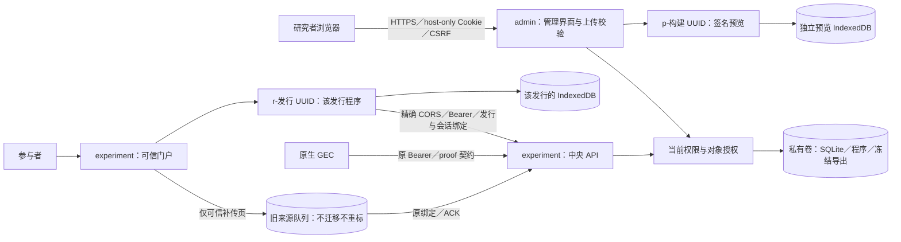

# GEP 防御性安全审计

日期：2026-10-22。审计基线：`641ca053c65aea119d2221ab75a7b6b4f8f7fdb0`；工作分支：`codex/security-audit-20261022`。

状态：**初版报告、最小补丁及用户追加授权的来源隔离已实施；安全验收未通过。** 初版报告与修复前复现先提交为 `4603cdf`，第一批修复为 `005b782`，之后继续来源隔离。旧来源缓存风险、镜像组件公告及失败／未运行的验收项仍未关闭。正式 v0.1.0 镜像、标签和附件未更新；没有部署、公开推送或发布漏洞利用结果到远端。

## 1. 结论、范围与证据等级

没有发现并验证 Critical 级远程代码执行或无需被盗凭据的服务器端跨研究原始数据读取；这不等于证明其不存在。基线验证了两项 High：共享 experiment origin 暴露其他研究本地记录及凭据；JSON Schema 回溯正则阻塞验证。**分支已封堵新入口的同源路径并禁用正则，均未部署**；旧缓存、已暴露凭据及真实部署的剩余风险不能整体关闭。服务器对象授权检查不能替代浏览器来源隔离。

本次重新从代码取证，不把历史 Phase 通过记录当作新证据。审计和补丁由同一执行者完成，未接受第三方机构或外部审计员复核，不构成 ASVS 等级认证。范围涵盖后端、模板／脚本、GEC Web／Godot 源码、上传与分发、依赖锁文件、Docker、部署脚本及本地可达 Git 历史；不含生产主机、DNS、实际证书信任、真实数据库、真实被试或系统账户秘密。

证据分为：

- **已验证**：合成数据库中的真实应用请求、真实 Chrome，或受控子进程中的同一验证函数，结果可重复。
- **静态风险**：代码／配置／版本与公告能建立风险条件，未实际执行漏洞利用。
- **未确认**：没有目标运行时、服务器、目标系统或足够证据。公开旧镜像已静态盘点，但不等于检查了正在运行的实例。不能把未确认改写为“不受影响”。

验证只使用临时数据库、测试归档和合成记录。秘密扫描只读 Git 跟踪文件与可达对象，关闭在线凭据验证；没有读取或上传真实被试数据、生产数据库、运行实例密钥或备份。

## 2. 实际架构与依赖

| 组件 | 源码／锁定值 | 审计结论与限制 |
|---|---|---|
| 后端 | `pyproject.toml`、`requirements.txt`：Python 3.12、Django 5.2.18、Gunicorn 25.3.0、jsonschema 4.26.0、openpyxl 3.1.5 | Django ORM、服务端模板；不是 PHP 或 Node 服务端 |
| 数据库 | `server/gep/settings.py`：SQLite，IMMEDIATE 事务，单 Gunicorn worker／4 threads | 数据文件在私有卷；SQLite 不监听网络端口；并发与磁盘上限仍需部署验证 |
| Web | 服务端模板、白名单 JS；GEC 原生 ES modules、IndexedDB／Web Locks；新分支逐发行 r-/逐预览 p- 来源＋中央 API 精确 CORS | 无 npm 生产前端依赖；Playwright 1.58.2 仅开发／测试。原版镜像仍同源，不能拿源码补丁冒充已升级 |
| 路由登记 | 新增 `BrowserOrigin`／迁移 `0016_browser_origin` | 只存公开 r-/p- 标签，登记已有 Web 构建／发行，不复制参与者／记录／凭据；删除后只保留可信处理页／证书路由，不复活程序或授权 |
| 原生 SDK | `GEC_SDK/gec_godot/`：Godot 4.7.2、godot-sqlite v4.7 | 上游 v4.7 声明 SQLite 3.51.0；不能拿服务器 SQLite 版本代替原生库版本 |
| 容器 | 已发 0.1.0：Python 3.12.13、Debian 13.6、非 root gep／UID 10001；本分支 Dockerfile 更新为固定摘要的 Python 3.12.15-slim | 公开旧附件经过摘要核对和静态组件扫描；新镜像未构建／运行，不能据 Dockerfile 宣称部署已修复 |
| 代理 | `compose.public.yaml`：Caddy 2.11.7；应用不发布主机端口 | Caddy 只代理 HTTP，不配置 PHP／FastCGI；镜像 tag 未固定 digest |
| 部署 | 本地默认回环、只读 rootfs、私有持久卷、cap_drop、no-new-privileges；公开配置显式启用 HTTPS | 没有实际验证生产网络、证书、资源配额、备份恢复或主机补丁 |

### PHP 与指定 CVE

PHP 官方于 2026-10-21 披露 CVE-2026-109618／CVE-2026-109619，涉及请求内存／错误清理状态导致内存损坏和潜在未认证 RCE。官方修复版本是 8.2.35、8.3.36、8.4.27、8.5.12；旧版本须按发行商回补情况判断，而不是仅看版本字符串。[PHP 官方公告](https://www.php.net/archive/2026.php#2026-10-21-1)、[109618 上游公告](https://github.com/php/php-src/security/advisories/GHSA-w8hw-w9fx-j79w)、[109619 上游公告](https://github.com/php/php-src/security/advisories/GHSA-6wmf-4rv5-p3rp)。

源码、运行依赖、Dockerfile 和 Compose 未引入 PHP／php-fpm／mod_php／FastCGI。另静态检查公开 Release 的 `gep_0_1_0_docker_linux_amd64.zip`：57,309,535 字节，SHA-256 与公开附件摘要一致（`839f544a8b20496686c5265e96f2340f9d79ba95deb6fa7fab7c8c9fc3abf8fe`）。遍历 11 个镜像层、14,611 个路径并读取包元数据，87 个 Debian 二进制包中未见 PHP，镜像路径也未见 PHP；没有启动镜像或读取应用数据文件。

结论：**已审源码及这份公开原版镜像不受这两项 PHP CVE 影响**。镜像 revision 是 `8d822b544559477f95fd520c9060df0c7ed87a58`，不等于当前分支。本机无 Docker CLI，未登录 Windows／VPS：实际部署是否改装、宿主及同机其他应用是否有 PHP仍未确认。不能据此宣称整台服务器安全。

### 依赖与仓库秘密

生产 Python 锁定包 13 个，pip-audit 未命中公告；完整当前平台开发集合 18 个，原 pytest 8.4.2 命中 CVE-2025-71176（两条重复记录计一个 CVE），升级到 9.0.3 后重扫为零。另单独核对 Windows 条件包 colorama 0.4.6／tzdata 2026.3，未命中；pnpm audit 的 4 个开发包未命中。生产 requirements 未改变，开发升级没有修改原 `.venv`。[pytest 官方修复](https://github.com/pytest-dev/pytest/releases/tag/9.0.3)、[漏洞公告](https://github.com/advisories/GHSA-6w46-j5rx-g56g)。

旧镜像还含 pip 25.0.1 和上述 13 个生产包。OSV 对去重后的 61 个 Debian 源包／14 个 PyPI 包查询共 75 次，22 个组件匹配 139 个不同公告 ID，**不是 139 个已验证漏洞**。已检查部分调用前提和 Debian 标记，未完成全部发行商回补／可达性裁定；高危乃至严重问题仍不能排除（SA-09）。例如 pip 旧 tar 回退漏洞在支持 PEP 706 的 Python 3.12 不走该路径；另有 pip 归档混淆公告，仅安装工具调用路径适用，GEP 没有 HTTP 请求触发 pip 安装的入口。zlib 两项公告要求组合 CRC 或非阻塞 gz* API，未发现 GEP 调用这些接口，但不据此豁免其他组件。[pip 回退前提](https://github.com/advisories/GHSA-4xh5-x5gv-qwph)、[pip 归档混淆](https://github.com/advisories/GHSA-58qw-9mgm-455v)、[Debian zlib 27171](https://security-tracker.debian.org/tracker/CVE-2026-27171)、[Debian zlib 85091](https://security-tracker.debian.org/tracker/CVE-2026-85091)。

这些查询只发送公开包名／版本／生态，不发送源码、数据库或秘密。扫描结果只代表查询时漏洞库的覆盖；CPython、Caddy／Go、Godot 引擎和原生插件另作上游公告核对，不因 Python／npm 零命中就判定它们安全。新 Docker 基础摘要已核对官方注册表，但目标镜像实际 SBOM／扫描／运行仍未完成。

Django 5.2.18 为受支持 5.2 LTS 的当前补丁；Godot、godot-sqlite、Caddy 有上游维护活动，未确认已停维护组件，也未凭“版本较旧”作此断言。原生插件的嵌入 SQLite 3.51.0 需要独立跟踪，不能拿镜像的系统 libsqlite3 3.46.1-7+deb13u1 代替；后者可能有发行商回补。SQLite FTS5 公告需要任意 SQL 等前提，GEC 的固定参数化查询未建立该攻击路径；原生 WAL 场景和完整版本适用性仍需目标环境复核。[Django 支持矩阵](https://www.djangoproject.com/download/)、[插件 v4.7](https://github.com/2shady4u/godot-sqlite/releases/tag/v4.7)、[SQLite 官方 CVE 说明](https://www.sqlite.org/cves.html)。

秘密扫描覆盖审计时 140 个可达提交、1,192 个唯一 blob（1,163 个文本，29 个二进制不作文本扫描）。未命中厂商 API key、私钥等专用凭据模式；关键词命中包括测试常量和 UI 文案，熵规则大量命中依赖摘要／素材。候选只以位置／类别保存并本地复核，未联网验证其有效性。扫描不能证明没有二进制夹带、弱／自定义格式秘密、远端已删引用或外部 fork；不读取忽略目录中的账号文件以“验证”候选。

## 3. 威胁模型与信任边界

保护资产：研究者身份及授权、参与者标识与原始事件、冻结程序／配置／完成声明、私有数据库和导出、参与者设备待传数据及整个服务的可用性。

攻击主体包括未登录网络用户、持有一个合法参与会话的恶意客户端、权限有限的研究者、恶意上传的实验程序、被盗研究者账户，以及掌握宿主或数据卷访问权的操作者。持有宿主 root／Docker 管理权已跨越应用信任边界，不能由 GEP 应用权限挽救。



公网方案的 TLS 边界在 Caddy，再由私有 Docker 网络转入应用；本地默认回环 HTTP，不冒充公网 HTTPS。镜像只含公开代码／依赖，数据库、密钥、原始记录和导出留在私有卷；下载到研究者电脑的导出和原生客户端本地 SQLite 又进入各自设备／备份的信任边界。实际主机与日志／备份系统未接入本次审计。

重要边界：HTTP Host／Origin 不是身份，非浏览器可以伪造它们；UUID 不是凭据；客户端提供的 participant／study／release／build／session 不可自行决定归属。服务器授权和浏览器隔离是两件事；新分支同时核对这两层，原版及旧缓存仍见 SA-01。参与者终端始终不可信：Bearer 证明会话权限，不证明是真人、按程序响应、真实 RT 或不可伪造的随机分组。GEP 没有权威服务端分组模块，不应把它描述成已经提供分组防篡改。

## 4. 风险清单与最小修复

Critical：本次无已验证项；High、Medium、Low 如下。严重性结合当前可达路径，不把上游 CVSS 直接套作 GEP 的实际可利用等级。

| ID | 等级／证据 | 位置与原因 | 影响及方案 | 当前状态 |
|---|---|---|---|---|
| SA-01 | **High／基线已验证；旧环境残余未确认** | 原 `server/core/hosting.py` 与 `GEC_SDK/gec_web/sdk.js` 共享来源；修复在 `server/core/origins.py`、`hosting.py`、`legacy_queue.py`、`views.py` 与代理模板 | 已改逐发行／预览来源、主机与程序绑定、精确 CORS＋发行/session 授权；门户不再执行上传代码。旧数据留原库，仅可信页按原 ACK 补传。真实 Chrome 的跨研究读取和已知他人 token 路径均拒绝 | **新入口分支已封堵；旧缓存／已泄露凭据／实际部署未验证，不能整体关闭 High** |
| SA-02 | **High／已验证验证器阻塞** | `server/core/packages.py:71`、`server/core/services.py:159,295`、新增 `server/core/schema_policy.py:15` | 小 Schema 与 33 字符合成值使子进程到 2 秒截止仍未完成；未攻击服务。经用户明确同意，注册／旧发行新准入／相关事件都先拒绝 `pattern`／`patternProperties`；普通字段名不误拦、混合批次原子拒绝，已有数据不改写。一般 Schema 复杂度仍无独立执行预算 | **分支已封堵，未部署；兼容性变化已确认** |
| SA-03 | **Medium／已验证限速绕过** | `server/core/views.py:43`、`server/core/throttle.py:7`：原计数键含请求自选 operation／ID | 原先更换 operation 后 121 个微小无效请求均无来源门槛；现在解析前固定全局 600/min、直接来源 120/min，再做原细分限速。第 121 个来源请求返回 429／Retry-After；不信任 X-Forwarded-For，不限事件上传 | **分支已修复，未部署；代理共享预算和计数保留仍需配置** |
| SA-04 | **Medium／已验证检查顺序；CVE 组件条件静态匹配** | `server/core/excel.py:79`、`server/core/packages.py:481,517`、新增 `server/core/archives.py`、`deploy/Dockerfile:1` | 原 XLSX 在总预算前读关系文件，原生包先读载荷；微小归档与调用探针复现，无压缩炸弹。现完整目录预算先行，只允许 Stored／Deflate，XLSX 新增 256 成员上限，并更新 Python 3.12.15 固定摘要，避免进入 CVE-2026-15310 所涉 BZIP2／LZMA 读取器 | **应用入口已封堵；新镜像未构建，旧镜像未替换** |
| SA-05 | **Low／已验证** | `server/core/protocol.py:34,86`；`server/core/views.py` 的 API 解析点 | 原大整数转换浮点或非对象 JSON 可触发通用 500；未证实堆栈泄漏。现先查数值范围并强制 API 根对象，返回受控 4xx，不回显输入，不限制合法事件 payload 的 JSON 类型 | **分支已修复，未部署** |
| SA-06 | **Medium／静态策略差距** | `server/core/researcher_passwords.py`、首次设置／改密：最低 6 位、强制字符类别，无已泄漏密码表／MFA／通行密钥 | 不满足 ASVS 5.0 的最低密码长度要求，单因子账号对被盗／弱口令防护有限。应由使用者确认更强新密码策略及渐进改密／MFA；不擅自改旧密码、锁定账户或重置用户 Owner | **开放；策略待决定** |
| SA-07 | **Low／静态部署风险** | `compose.yaml`／`compose.public.yaml`／`deploy/Caddyfile`：未设容器 CPU／内存／PID 配额、边缘流量控制；限速行无过期清理；Caddy 未固定摘要 | 持续异常流量、合法大包／大导出或日志增长仍可影响可用性。需针对实际负载设置配额、磁盘监控、可信代理限速和计数保留策略，不用随意小内存上限让合法游戏／导出 OOM | **开放；生产容量与代理配置未验证** |
| SA-08 | **Medium／已知开发依赖 CVE，未在本机利用** | `pyproject.toml`／`uv.lock`：原 pytest 8.4.2，CVE-2025-71176（Unix 可预测临时目录） | 升级至官方修复的 9.0.3，18 个当前平台开发包重扫零命中；Windows 条件包另扫。生产 requirements 不含 pytest；原 `.venv` 和证据保留，新隔离环境完成回归 | **开发锁定已修复；原开发环境未自动替换** |
| SA-09 | **未裁定／静态组件匹配** | 公开 0.1.0 镜像的 OS／安装工具组件，见 §2 | 139 个公告 ID 的发行商回补／调用前提未全部裁定；不能当作 139 个已验证漏洞，也不能统一降为 Low／Medium。**潜在 High／Critical 未排除**；需要在隔离环境构建目标镜像并逐项裁定，Caddy／Go 也另扫 | **部署阻断项，未完成** |
| SA-10 | **Medium／已验证匿名解析先于鉴权** | `server/gep/settings.py` 中间件；新增 `server/core/limits.py:54` | 有公开 CSRF Cookie 的匿名 POST 原可先触发 multipart 解析；两个上传路由微小探针修复前失败。现在 CSRF 视图解析前拒绝匿名上传，不读取正文；已登录请求仍保留 CSRF、当前对象／操作鉴权 | **分支已修复，未部署；不代替实际资源配额** |
| SA-11 | **Medium／已验证 Cookie 账户替换** | `server/gep/settings.py`：HTTPS 仍用无主机约束前缀的 `gep_admin`／默认 CSRF Cookie；host-only 不阻止同站子域注入父域同名 Cookie | 新 Chrome 中，子域脚本注入攻击者自己的有效合成 Session Cookie，浏览器实际请求头交给真实 Django 后，身份从合成受害者变成攻击者；不是盗取受害者 Cookie 或提升为 Owner。拟在 HTTPS 使用 `__Host-` 前缀＋Secure／Path=/／无 Domain，HTTP 本地模式兼容；升级需重新登录，不改数据库账号 | **已提交补充发现，修复待实施** |

SA-01 的 Chrome 证据：同一全新浏览器上下文先在研究 A 用真实 GEC 开始并本地提交记录，关闭客户端连接，再打开仅有研究 B 权限用户签发的 B 预览。结果 `crossStudyRead=true, proofExposed=true, tokenAccepted=true, preview=true`。没有真实被试数据或跨设备攻击；这不是“不用 token 就能读服务器数据”，而是同源脚本能盗取本地 token。

SA-02 的前后同值证据：原基线注册接受，实际 `validate_event` 在子进程 2 秒期限内未返回，受控终止；补丁注册和事件验证均以 `schema_regex_unsupported` 拒绝，进程退出 0、约 0.190 秒（含 Django 初始化，**不是性能基准**）。外部服务／数据库未参与，不测并发拒绝服务规模，也不以此断言任意 Schema 都有问题。

SA-01 修复后沿用同一 GEC 维护源、实际准入和 IndexedDB 记录，在独立 B 预览读取 A 的结果变为 `crossStudyRead=false, proofExposed=false`，预览 API 被浏览器／服务端拒绝。另一个正常发行 B 也看到空库，即使测试专门给它 A 的有效 token，服务端仍返回 `origin_binding` 403。不是通过只改数据库名字或清缓存“修复”。原攻击脚本与成功证据留在 `4603cdf`／原 XML，现测试改为对应拒绝回归。

用户明确授权继续来源隔离但不改实际域名。旧队列方案采用**留在原地、可信页面补传**，不做跨来源复制／重标／自动续试；新来源与新缓存机制不借此擦除旧现场。公开路由标签只保留无身份的 UUID 标签，使研究删除后仍可处理旧队列并取得原 `study_deleted` 拒绝，不能访问／重新发布已删程序。完整缓存的旧恶意脚本／Service Worker 或已复制的凭据无法据此追溯撤回；实际旧浏览器未检查，因此保留 High 残余门槛。原版镜像未升级前仍不允许据分支结果宣称来源隔离已生效。

公开模板需 `*.experiment.<domain>` DNS，采用内部按名称许可的逐名称 On-Demand TLS，不需 DNS-provider 密钥；内部许可路由被公网代理阻断。已用摘要核对的官方 Caddy 2.11.7 对保留的 `audit.invalid` 模板完成适配／配置验证（未启动监听、申请证书或建立信任）。不等于实际 ACME／CA 配额／完整证书链验收。[Caddy 官方许可机制](https://caddyserver.com/docs/caddyfile/options#on-demand-tls)、[CORS 浏览器边界](https://developer.mozilla.org/en-US/docs/Web/HTTP/Guides/CORS)。

上游 Python 修复依据：[Python 3.12.15](https://www.python.org/downloads/release/python-31215/)。Caddy 的 [CVE-2026-55458](https://github.com/caddyserver/caddy/security/advisories/GHSA-8qx7-j2v2-x6q5) 涉及 101／WebSocket 升级响应；当前 GEP 无 WebSocket／101 或 FastCGI 路由，未建立适用攻击路径，不把它列成已验证 GEP 漏洞。实际 Caddy 二进制／Go 依赖尚未扫描。

SA-11 的 HTTPS 页面由 Playwright 在新上下文中本地 fulfill，未接触 DNS／证书／外部站点；浏览器实际 Cookie 优先级和真实 Django 合成账户身份均参与，不是手工伪造最终 Cookie 头。修复前 `victim_active=false, attacker_active=true`（`before_cookie_prefix_run03.xml`）；首次探针误读默认 Cookie 配置的失败也保留。此证据不证明部署 TLS 已验证，也不声称原账号凭据已泄漏。[浏览器 Cookie 前缀要求](https://developer.mozilla.org/en-US/docs/Web/HTTP/Reference/Headers/Set-Cookie#cookie_prefixes)。

## 5. 标识符、权限与重点审查矩阵

| 入口／对象 | 服务器实际检查 | 核验与限制 |
|---|---|---|
| `POST /v1/participant/sessions`：study／release／build／operation | `admit_request` → 锁定 study／release；实例与归属相等；冻结参与模式／招募／名单／密码；重放须同 proof 和原绑定 | 随机 UUID 不授予身份；ID-only 是名单码模式，不证明现实身份。SA-03 总预算和 SA-02 旧定义门槛已增补 |
| `/<session_id>/event-batches` | 查真实 session→study→release；Bearer 摘要、过期／撤销；envelope session 相等；类型／Schema；冲突整批回滚 | 四类错 token、错 envelope、混合不合法 Schema 回滚已通过；无法证明客户端响应真实。SA-02 在验证器前拒绝 |
| `/<session_id>/completion`、`status`、`context` | 同一 token／会话／研究生命周期；声明只包含 UUID 集合，不通过客户端身份代替归属 | 新增 token 替换负向检查已通过；空完成集合是协议能力，不等于现实任务完成 |
| `/<session_id>/recover`、`POST /v1/participant/recovery` | 原 proof、一次性许可／码、当前签发者权限／过期／消费、固定实例／研究／发行／构建；具期限速 | UI 隐藏不是 API 关闭。需继续保留恢复契约回归；原恢复问题不据本审计宣称全部已修 |
| `/studies/<study_id>/*`、名单模板／导入 | admin host＋登录＋study.view＋模块／操作权限；导入预览绑定 actor／study／revision，提交重新授权和本人密码；事务内重查删除 | 不信任 POST 中的 build／release／preview；取对象时带 study 过滤。上传代码只在独立来源提供，旧环境仍见 SA-01 |
| `/users`、账号／权限／邀请 | 从存储重读 Owner／角色／平台权限／目标权限，禁止 Owner／自身越权；确认密码／revision；临时密码强制改密；审计原子写入 | 不依赖隐藏按钮／is_staff；会话 auth_version 使停用／改密失效。密码策略为 SA-06 |
| `/v1/admin/exports`＋`/<export_id>/download` | 创建按 study 校验 data.export_raw／identity_mapping.read；session 选择必须归属 study；每种下载重查冻结权限集 | CSV 使用可逆 text:/json: 前缀，不把公式文本直接作为公式、不改 RAW；metadata 不透传凭据。导出／撤权矩阵与真实 Chrome 下载逐值对账已运行；目标 Windows 表格软件未实测 |
| `/releases/<release_id>/config,artifact,artifact/<member>` | admin host＋研究归属权限；批准／删除状态；artifact 固定路径和摘要；sidecar 白名单 | 不是任意 UUID 可下载。Web／原生公开配置不含账号或 token |
| `/run/<release_id>/…`、`/preview/<token>/…` | 逐发行／构建主机与路径相符；已发布 Web／有效签名预览＋当前 build.preview；路径限 web/；ZIP 读取而非文件系统路径拼接 | 发布资源本来公开；旧门户不再执行代码。已删除程序仍 404，已登记来源可显示可信本机处理页，但无 GEP_CONTEXT／实验程序 |
| `/local-data`、固定 `legacy-data/sdk.js`、内部 TLS 许可 | 门户或已登记独立来源才能访问可信处理页／SDK；TLS 许可仅私有 backend 主机和已知合法名称，公网代理阻断 | 页不返回服务器答案；仅本机 SDK 按原 config／instance、暂停、退避和 ACK 补传；不提供恢复、新参与或清库按钮 |
| 公开门户／`/join/<study_id>` | public 控制列表、当前发行／招募、删除状态；稳定入口带 revision 再由准入核对 | 知道私有 join UUID 可看受邀入口是当前设计，不等于 roster／历史可读；UUID 不能作为私密材料访问控制 |

其他审查：ORM／原生 SQL 使用绑定参数，未发现应用可达的字符串拼接 SQL；模板自动转义／后台 nonce CSP、CSRF 中间件和 host-only Cookie 都有代码控制；上传不在服务器执行、不提取任意 ZIP 路径，拒绝路径穿越／链接／重复名称、远程 Schema 引用；原生 HTTP 不跟随重定向且未配置跳过 TLS 校验。服务器日志／导出／备份的实际采集、留存、权限和第三方转发未读取生产配置，仍需人工核查。

## 6. 标准映射与未声称的覆盖

参考正式 [OWASP ASVS 5.0.0](https://github.com/OWASP/ASVS/releases/tag/v5.0.0) 与 [OWASP API Security Top 10 2023](https://api-security.owasp.org/editions/2023/en/0x11-t10/)。这是风险驱动控制映射，不是对所有 ASVS 条款逐项认证。

| 控制面 | ASVS 5.0 | API Top 10 | 状态 |
|---|---|---|---|
| 输入／注入／业务顺序 | V1／V2／V4 | API3／API6／API10 | ORM／JSON 绑定有覆盖；正则入口已封堵，一般验证预算未证明 |
| 浏览器／会话／对象隔离 | V3／V7／V8 | API1／API2／API5 | 新分支逐发行／预览隔离已验证；旧缓存／实际部署未验证 |
| 上传、解析、资源限制 | V5／V15 | API4 | 归档预算和匿名解析顺序已修复；实际容量／配额未验证 |
| 账户和密码 | V6（含 6.2.1）、V7 | API2 | 限速／改密／停用有控制；6 位最低长度不符合要求 |
| Token／密钥／TLS | V9／V11／V12 | API2／API8 | 服务器 HMAC／哈希，不使用 JWT；生产 TLS／密钥托管未确认 |
| 配置／依赖／数据／错误 | V13／V14／V16 | API8／API9 | 旧镜像静态扫描和 JSON 错误修复；新镜像／宿主／日志未确认 |
| SSRF | V4／V5 | API7 | 未发现接受任意 URL 并由服务端抓取的应用入口；Schema 外链拒绝 |
| 不采用的功能 | V10 OAuth/OIDC、V17 WebRTC | — | 当前源码未采用；不据此声称其他控制全部通过 |

## 7. 修复前后与最终回归

修复前 `tests/test_security_audit.py`：15 failed、5 passed、1 skipped（真实浏览器项单独运行）。15 个失败分别复现限速缺失、非对象／大整数 500、归档检查顺序和非标准解压器接受；失败是本轮证据，不删除或改成通过。

真实 Chrome 的 SA-01 演示：1 passed，**表示成功重现未关闭风险，不是修复通过**。首次在沙箱中因禁止绑定端口未运行，保留该失败；获准后仅在本地回环临时服务验证成功。

| 检查 | 实际结果 | 解释 |
|---|---|---|
| 修复前安全用例 | 15 failed／5 passed／1 skipped | 限速、JSON、归档顺序／压缩方式的失败证据保留在 `before.xml` |
| 匿名解析门槛修复前 | 2 failed | `before_upload_gate.xml`；持 CSRF Cookie 的匿名微小 multipart 已进入解析器 |
| 正则同值前后探针 | 基线超时并终止；补丁两处拒绝 | `regex_before_after.json`；无网络／数据库，没有无界攻击运行 |
| 第一批补丁回归 | **303 passed／1 failed／0 skipped**，54.17 秒 | `final_security_and_contracts.xml`；当时包括成功重现尚未修复的同源风险，不冒充来源隔离通过 |
| 来源隔离、路由迁移、删除／权限／恢复／导出最终定向 | **350 passed／1 failed／0 skipped**，84.21 秒 | `final_isolation_with_deletion.xml`，Python 3.12.15／pytest 9.0.3，351 项；含 40 个初批安全用例及来源隔离增量。唯一失败仍是基线同样失败的隐藏恢复码按钮断言 |
| 该组真实 Chrome | 6 passed | 预览／另一个发行的跨来源拒绝、旧库关闭重开→补传→ACK 后清理、CSP、两项 ZIP 导出／错误反馈、删除流程；这轮来源隔离通过不覆盖旧缓存或原版部署 |
| 原有完整默认测试（中间补丁状态） | **838 passed／30 failed／30 skipped**，约 18 分 55 秒 | `full_suite.xml`；在后加的匿名门槛／正则补丁前运行，不冒充最终快照全量通过。最终相关契约另按上行重测 |
| 最终来源隔离的其余完整集合 | **877 passed／22 failed／31 skipped，另 8 deselected**，330.23 秒 | `final_suite_scoped_run02.xml`；明确不重跑上行已留存的 8 个真实 SDK 失败／超时项。22 fail 全为已对照的 12 个旧 UI 断言＋10 项缺历史包，不当作全绿 |
| 原基线 UI 对照 | 12 个旧断言均失败；另 2 个旧浏览器流程均失败 | 3 项 Excel、9 项账号／名单／恢复 GUI 对照与当前失败位置一致，非本轮引入；不删除失败用例“做绿” |
| 原完整测试其余失败 | 10 项缺历史 `build/synthetic_web.zip`；8 项真实 Godot／Web harness 失败或超时 | 保留失败。未重建／覆盖冻结旧包，未全部完成基线归因；**仍需修复测试前置和排查，不能当成通过** |
| 合成 SQLite 逻辑备份＋只读恢复 | 通过 | 核对 integrity_check、事件原值、权限、撤销、实例 UUID；不是完整卷／密钥恢复演练，也不是生产 RPO／RTO 验收 |
| 新 Docker／Windows／实际公网 | **未运行** | 无 Docker CLI／目标设备连接，不更新用户服务，不把源码／交叉平台包检查当作运行通过 |

完整默认测试的 30 个 skipped 均为未启用的可选真实浏览器项；上述 6 项在后续定向组明确启用并运行，其余未在本轮逐项补齐。两个原生 harness 超时为 300 秒／180 秒，已退出，不靠重启或清队列掩盖。`baseline_remaining_ui.xml` 首次对照因隔离源码缺工具目录而未收集到测试，补齐**仅 Git 跟踪的工具**后另存 `baseline_remaining_ui_run02.xml`；原错误文件保留。来源隔离中间运行的旧同源 URL／配置前置断言及一个新用例取错删除作业返回类型的失败也保留，不当作最终通过。

最终复现入口（在仅有合成数据的本机测试环境）：

```sh
# 使用同步了本分支 dev 锁定依赖的 Python 3.12 环境。
GEP_T17_BROWSER=1 python -m pytest -q \
  tests/test_source_isolation.py tests/test_security_audit.py tests/test_security.py tests/test_protocol.py \
  tests/test_transactions.py tests/test_deploy_proxy.py tests/test_first_run.py \
  tests/test_runtime.py tests/test_gec_addon.py tests/test_gui_packages.py \
  tests/test_phase03_packages.py tests/test_phase03_windows_packages.py \
  tests/test_phase03_permissions.py tests/test_phase03_releases.py \
  tests/remediation/test_p03_scope_boundaries.py tests/remediation/test_p03r04.py \
  tests/remediation/test_p03r04_regressions.py \
  tests/remediation/test_p03r07.py tests/remediation/test_p03r07r.py \
  tests/remediation/test_p03r08.py tests/test_phase03_recovery_codes.py
```

原默认整套入口为 `python -m pytest -q`，不表示目前能全绿。浏览器检查需仓库锁定的开发浏览器依赖和本机 Chrome，只启动 pytest 临时库／回环服务，不连接现有实例。

科学／数据契约：`GEC_SDK/` 和游戏主体字节、导出编码／恢复协议未改，没有新增或改动随机分组、评分和科学计时。新增路由标签迁移只登记公开标签，合成旧库的原事件、config、token_hash 原值核对通过；未操作用户卷。事件幂等、不同 ID 同值、冲突整批回滚、完成集合、JSON 类型／顺序、冻结导出及删除后的原永久拒绝均纳入定向验证。确认的兼容变化是正则禁用和浏览器逐发行来源：旧任务不自动跨来源续试，不重标／删除待传数据。“自己 token 可编造合法事件”的合成验证通过，说明这不是反作弊／真人／任务执行证明。8 项真实 SDK harness 失败未关闭，新 Windows／macOS 实机和物理故障验收未完成。

机器证据仅本地：`local_data/security_audit_20261022/`；报告／扫描脚本及脱敏结果在 `docs/internal/completed/reports/security_audit_20261022/`，不进公开仓库。公开报告不包含账号秘密、真实数据或生产目标信息。

## 8. 部署前检查表

- [ ] 在目标部署和旧设备关闭 SA-01 的残余边界：处理旧队列、检查完整旧缓存／Service Worker 与曾暴露凭据，不用清库掩盖风险；原版升级前不能据分支测试宣称隔离已生效。
- [ ] SA-02 补丁部署前先核对旧冻结 Schema 是否使用正则、受影响待传记录与兼容发布安排；不删数据或跳过校验。只读检查真实数据另需授权，本轮没有进行。
- [ ] 在隔离环境构建补丁镜像，逐项裁定 SA-09，并核对 CPython／OS／OpenSSL／SQLite／Caddy／Go 的实际 SBOM 与公告；检查宿主／其他应用是否另装 PHP 及其补丁。
- [ ] 保留旧 API／卷／实例，演练 `0016_browser_origin` 与只含标签的回填；实际运行不会自动迁移旧卷。验证 wildcard DNS、内部 TLS 许可阻断／逐名称 ACME、证书续期／配额和 CSP／CORS；不忽略 TLS 或回退同源实验。
- [ ] 合成数据验证 HTTPS、完整证书链、续期、HTTP 入口策略、secure Cookie、受控代理头；后台和程序来源不混用。
- [ ] 实例私有卷、secret、数据库／WAL／导出／备份仅服务账号和授权维护者可读；不放入网站目录或 Git；设置密钥轮换／撤销流程。
- [ ] 检查各研究与各账户的权限矩阵、临时密码首次改密、停用与撤权生效；决定更强密码／MFA 策略。
- [ ] 用实际合法大包／导出估算资源与磁盘预算，再设容器／代理配额、告警、限速和计数／日志保留；不要对生产做压力测试。
- [ ] 在隔离合成卷演练完整一致性备份与恢复，包含数据库／私有密钥／程序／配置／导出，核对撤销／删除标记、权限和事件；本轮逻辑数据库测试不替代此项，不能复制真实数据库来完成本审计。
- [ ] 检查代理访问日志／浏览器历史中的邀请和预览 URL、错误日志、备份位置、第三方日志转发；禁止记录密码、Bearer、proof 或请求正文。
- [ ] 修复全套测试的前置条件和旧断言，排查 8 项真实 harness 失败，再对最终镜像／目标设备复验；没有确认的数据不删、不重标、不静默恢复。
- [ ] 由部署负责人审核所有开放 High 和未确认生产条件；人工签字与明确授权后才部署，不自动改正式标签／附件。

**最终判定：本轮报告与最小补丁已交付，但安全验收不通过；不满足高风险关闭及目标部署验证条件。没有系统绝对安全的结论，也不批准生产使用。**
