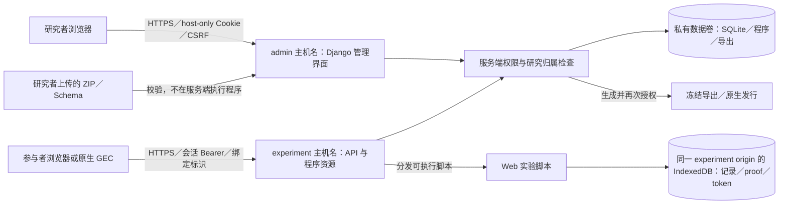

# GEP 防御性安全审计

日期：2026-10-22。审计基线：`641ca053c65aea119d2221ab75a7b6b4f8f7fdb0`；工作分支：`codex/security-audit-20261022`。

**初版报告，先于修复提交。** 修复和最终回归尚未完成，下面的“待修复／待确认”不得视为已经关闭。正式 v0.1.0 镜像、标签和附件未更新，也没有部署到现有服务器。

## 1. 结论、范围与证据等级

没有发现并验证 Critical 级远程代码执行或服务器端跨研究读取原始数据的漏洞；这不等于证明其不存在。已验证两项 High 风险：共享 experiment origin 暴露其他研究的本地记录及会话凭据；不受时间约束的 JSON Schema 正则可阻塞事件验证。

本次重新从代码取证，不把历史 Phase 通过记录当作新证据。审计和补丁由同一执行者完成，未接受第三方机构或外部审计员复核，不构成 ASVS 等级认证。范围涵盖后端、模板／脚本、GEC Web／Godot 源码、上传与分发、依赖锁文件、Docker、部署脚本及本地可达 Git 历史；不含生产主机、DNS、实际证书信任、真实数据库、真实被试或系统账户秘密。

证据分为：

- **已验证**：合成数据库中的真实应用请求、真实 Chrome，或受控子进程中的同一验证函数，结果可重复。
- **静态风险**：代码／配置／版本与公告能建立风险条件，未实际执行漏洞利用。
- **未确认**：当前环境没有目标镜像、服务器、目标系统或足够证据。不能改写为“不受影响”。

验证只使用临时数据库、测试归档和合成记录。秘密扫描只读 Git 跟踪文件与可达对象，关闭在线凭据验证；没有读取或上传真实被试数据、生产数据库、运行实例密钥或备份。

## 2. 实际架构与依赖

| 组件 | 源码／锁定值 | 审计结论与限制 |
|---|---|---|
| 后端 | `pyproject.toml`、`requirements.txt`：Python 3.12、Django 5.2.18、Gunicorn 25.3.0、jsonschema 4.26.0、openpyxl 3.1.5 | Django ORM、服务端模板；不是 PHP 或 Node 服务端 |
| 数据库 | `server/gep/settings.py`：SQLite，IMMEDIATE 事务，单 Gunicorn worker／4 threads | 数据文件在私有卷；SQLite 不监听网络端口；并发与磁盘上限仍需部署验证 |
| Web | `server/core/templates/`、静态白名单 JS；`GEC_SDK/gec_web/` 原生 ES modules、IndexedDB／Web Locks | 没有 npm 生产前端依赖；Playwright 1.58.2 仅开发／测试 |
| 原生 SDK | `GEC_SDK/gec_godot/`：Godot 4.7.2、godot-sqlite v4.7 | 上游 v4.7 声明 SQLite 3.51.0；不能拿服务器 SQLite 版本代替原生库版本 |
| 容器 | `deploy/Dockerfile`：固定摘要的 Python 3.12.13-slim；非 root UID 10001 | 基础 Python 落后于 3.12.15；OS 包和实际发布镜像尚未扫描 |
| 代理 | `compose.public.yaml`：Caddy 2.11.7；应用不发布主机端口 | Caddy 只代理 HTTP，不配置 PHP／FastCGI；镜像 tag 未固定 digest |
| 部署 | 本地默认回环、只读 rootfs、私有持久卷、cap_drop、no-new-privileges；公开配置显式启用 HTTPS | 没有实际验证生产网络、证书、资源配额、备份恢复或主机补丁 |

### PHP 与指定 CVE

PHP 官方于 2026-10-21 披露 CVE-2026-109618／CVE-2026-109619，涉及请求内存／错误清理状态导致内存损坏和潜在未认证 RCE。官方修复版本是 8.2.35、8.3.36、8.4.27、8.5.12；旧版本须按发行商回补情况判断，而不是仅看版本字符串。[PHP 官方公告](https://www.php.net/archive/2026.php#2026-10-21-1)、[109618 上游公告](https://github.com/php/php-src/security/advisories/GHSA-w8hw-w9fx-j79w)、[109619 上游公告](https://github.com/php/php-src/security/advisories/GHSA-6wmf-4rv5-p3rp)。

在本仓源码、运行依赖、Dockerfile 和 Compose 中未发现引入 PHP、php-fpm、mod_php 或 FastCGI 的路径：**就已审源码构建组成而言，这两项 PHP CVE 不适用**。本机无 Docker CLI／可供审计的镜像运行时，本次未登录 Windows／VPS 或检查其进程与包清单，因此**实际镜像、同机其他应用和宿主是否装有 PHP：未确认**。不要把“不使用 PHP 的 GEP 应用”误报为“整台服务器安全”。

### 依赖与仓库秘密

生产 Python 锁定包的 pip-audit 扫描为 13 个包、未命中公告；pnpm audit 为 4 个开发包、未命中公告。扫描结果只代表查询时漏洞库的覆盖，不覆盖 CPython、Debian、OpenSSL、Caddy、Godot、SQLite 或未公开漏洞。开发依赖／跨平台条件依赖的补充核对与最终证据将在收尾更新。

Django 5.2.18 为受支持 5.2 LTS 的当前补丁；Godot、godot-sqlite、Caddy 有上游维护活动，未凭“版本较旧”断言其已失去维护。原生插件的嵌入 SQLite 需要单独追踪；已知 SQLite FTS5 CVE 需要任意 SQL 等前提，GEC 的固定参数化查询不满足该前提，不能直接宣称可远程利用。[Django 支持矩阵](https://www.djangoproject.com/download/)、[插件 v4.7](https://github.com/2shady4u/godot-sqlite/releases/tag/v4.7)、[SQLite 官方 CVE 说明](https://www.sqlite.org/cves.html)。

秘密扫描覆盖审计时 140 个可达提交、1,192 个唯一 blob（1,163 个文本，29 个二进制不作文本扫描）。未命中厂商 API key、私钥等专用凭据模式；关键词命中包括测试常量和 UI 文案，熵规则大量命中依赖摘要／素材。候选只以位置／类别保存并本地复核，未联网验证其有效性。扫描不能证明没有二进制夹带、弱／自定义格式秘密、远端已删引用或外部 fork；不读取忽略目录中的账号文件以“验证”候选。

## 3. 威胁模型与信任边界

保护资产：研究者身份及授权、参与者标识与原始事件、冻结程序／配置／完成声明、私有数据库和导出、参与者设备待传数据及整个服务的可用性。

攻击主体包括未登录网络用户、持有一个合法参与会话的恶意客户端、权限有限的研究者、恶意上传的实验程序、被盗研究者账户，以及掌握宿主或数据卷访问权的操作者。持有宿主 root／Docker 管理权已跨越应用信任边界，不能由 GEP 应用权限挽救。

重要边界：HTTP Host 不是身份；UUID 不是凭据；客户端提供的 participant／study／release／build／session 不可自行决定归属。不同研究在服务器的数据授权与不同实验脚本在浏览器中的隔离是两件事。当前后者未成立（SA-01）。参与者终端始终不可信：Bearer 证明会话权限，不证明是真人、按程序响应、真实 RT 或不可伪造的随机分组。GEP 没有权威服务端分组模块，不应把它描述成已经提供分组防篡改。

## 4. 风险清单与最小修复

Critical：本次无已验证项；High、Medium、Low 如下。严重性结合当前可达路径，不把上游 CVSS 直接套作 GEP 的实际可利用等级。

| ID | 等级／证据 | 位置与原因 | 影响及方案 | 当前状态 |
|---|---|---|---|---|
| SA-01 | **High／已验证** | `server/core/hosting.py:resource,preview,serve`；`GEC_SDK/gec_web/sdk.js:prepare,begin`：预览和所有研究共用 origin，凭据和记录在同一 `gec-1` 库 | 有自己研究预览权限的恶意上传者可在共享设备读另一研究的待传数据、proof、token，并持 token 读取其会话 context。需按信任单元隔离运行来源、预览和存储，设计旧队列迁移；仅改数据库名字、CSP nonce 或增加 API UUID 检查不能解决同源脚本访问 | **开放；架构修复未实施** |
| SA-02 | **High／已验证验证器阻塞** | `server/core/packages.py:schema_safe`、`server/core/services.py:validate_event`：接受 Python 回溯正则，事件校验无执行时间界限 | 小 Schema 与 33 字符合成 payload 在同一验证函数中超过 2 秒，子进程到期终止；未对服务实施压力测试。最小封堵是禁用 `pattern`／`patternProperties`，但旧发行兼容性会改变；完整兼容方案需有界正则或隔离验证 | **待用户确认契约变化；尚未修复** |
| SA-03 | **Medium／已验证限速绕过** | `server/core/views.py:participant`、`server/core/throttle.py:check`：准入计数键含请求自选的 operation／ID，无来源合计门槛 | 更换 operation 可持续产生计数行及准入工作。121 个微小无效合成请求均未被来源门槛限制。拟在解析和细分键前加固定全局／直接来源限速，保留细分限速；不在事件上传路径加限流 | 待修复 |
| SA-04 | **Medium／已验证检查顺序；上游 CVE 静态适用** | `server/core/excel.py:_archive` 在完整限额核对前解析 `.rels`；`server/core/packages.py:native_program_valid` 在目录预算核对前读载荷；`deploy/Dockerfile` 固定 Python 3.12.13 | ZIP 声明预算未先约束解析工作，且接受 BZIP2／LZMA，涉及 Python CVE-2026-15310 的解压内存风险。用微小归档与调用探针复现先读后拒，不构造大炸弹。拟先查所有成员和总预算，只允许 Stored／Deflate，并更新固定 Python 安全补丁镜像 | 待修复；新镜像实际构建／OS 扫描未确认 |
| SA-05 | **Low／已验证** | `server/core/protocol.py:validate_tree`；`server/core/views.py:participant,recovery`：大整数先转换浮点、非对象 JSON 被当字典使用 | 未认证微小请求可触发通用 500。DEBUG=False，未证实响应泄漏堆栈；影响为错误处理和日志／资源消耗。拟先检查数值范围，再强制 API 根对象，受控 4xx 且不回显输入 | 待修复 |
| SA-06 | **Medium／静态策略差距** | `server/core/researcher_passwords.py`、首次设置／改密：最低 6 位、强制字符类别，无已泄漏密码表／MFA／通行密钥 | 不满足 ASVS 5.0 的最低密码长度要求，单因子账号对被盗／弱口令防护有限。应由使用者确认更强新密码策略及渐进改密／MFA；不擅自改旧密码、锁定账户或重置用户 Owner | **开放；策略待决定** |
| SA-07 | **Low／静态部署风险** | `compose.yaml`／`compose.public.yaml`／`deploy/Caddyfile`：未设容器 CPU／内存／PID 配额、边缘流量控制；限速行无过期清理；Caddy 未固定摘要 | 持续异常流量、合法大包／大导出或日志增长仍可影响可用性。需针对实际负载设置配额、磁盘监控、可信代理限速和计数保留策略，不用随意小内存上限让合法游戏／导出 OOM | **开放；生产容量与代理配置未验证** |

SA-01 的 Chrome 证据：同一全新浏览器上下文先在研究 A 用真实 GEC 开始并本地提交记录，关闭客户端连接，再打开仅有研究 B 权限用户签发的 B 预览。结果 `crossStudyRead=true, proofExposed=true, tokenAccepted=true, preview=true`。没有真实被试数据或跨设备攻击；这不是“不用 token 就能读服务器数据”，而是同源脚本能盗取本地 token。

SA-02 的证据是实际 `validate_event` 函数的有界子进程运行，外部服务／数据库未参与；已证明验证器执行时间风险，未测量真实并发拒绝服务规模。不以该小样例断言任意 Schema 都有问题。

上游 Python 修复依据：[Python 3.12.15](https://www.python.org/downloads/release/python-31215/)。Caddy 的 [CVE-2026-55458](https://github.com/caddyserver/caddy/security/advisories/GHSA-8qx7-j2v2-x6q5) 涉及 101／WebSocket 升级响应；当前 GEP 无 WebSocket／101 或 FastCGI 路由，未建立适用攻击路径，不把它列成已验证 GEP 漏洞。实际 Caddy 二进制／Go 依赖尚未扫描。

## 5. 标识符、权限与重点审查矩阵

| 入口／对象 | 服务器实际检查 | 核验与限制 |
|---|---|---|
| `POST /v1/participant/sessions`：study／release／build／operation | `admit_request` → 锁定 study／release；实例与归属相等；冻结参与模式／招募／名单／密码；重放须同 proof 和原绑定 | 随机 UUID 不授予身份；ID-only 是名单码模式，不证明现实身份。存在 SA-03 |
| `/<session_id>/event-batches` | 查真实 session→study→release；Bearer 摘要、过期／撤销；envelope session 相等；类型／Schema；冲突整批回滚 | 新增四类错 token 检查和错 envelope 回滚已通过；无法证明客户端响应真实。存在 SA-02 |
| `/<session_id>/completion`、`status`、`context` | 同一 token／会话／研究生命周期；声明只包含 UUID 集合，不通过客户端身份代替归属 | 新增 token 替换负向检查已通过；空完成集合是协议能力，不等于现实任务完成 |
| `/<session_id>/recover`、`POST /v1/participant/recovery` | 原 proof、一次性许可／码、当前签发者权限／过期／消费、固定实例／研究／发行／构建；具期限速 | UI 隐藏不是 API 关闭。需继续保留恢复契约回归；原恢复问题不据本审计宣称全部已修 |
| `/studies/<study_id>/*`、名单模板／导入 | admin host＋登录＋study.view＋模块／操作权限；导入预览绑定 actor／study／revision，提交重新授权和本人密码；事务内重查删除 | 不信任 POST 中的 build／release／preview；取对象时带 study 过滤。恶意研究者上传 Web 仍存在 SA-01 |
| `/users`、账号／权限／邀请 | 从存储重读 Owner／角色／平台权限／目标权限，禁止 Owner／自身越权；确认密码／revision；临时密码强制改密；审计原子写入 | 不依赖隐藏按钮／is_staff；会话 auth_version 使停用／改密失效。密码策略为 SA-06 |
| `/v1/admin/exports`＋`/<export_id>/download` | 创建按 study 校验 data.export_raw／identity_mapping.read；session 选择必须归属 study；每种下载重查冻结权限集 | CSV 使用可逆 text:/json: 前缀，不执行公式、不改 RAW；metadata 不透传凭据。须运行导出／撤权矩阵回归 |
| `/releases/<release_id>/config,artifact,artifact/<member>` | admin host＋研究归属权限；批准／删除状态；artifact 固定路径和摘要；sidecar 白名单 | 不是任意 UUID 可下载。Web／原生公开配置不含账号或 token |
| `/run/<release_id>/…`、`/preview/<token>/…` | 已发布 Web／有效签名预览、当前 build.preview 权限；路径限 web/；ZIP 读取而非文件系统路径拼接 | 发布资源本来就是公开的，不是参与者数据 API；预览仅本地保存不等于浏览器安全隔离，见 SA-01 |
| 公开门户／`/join/<study_id>` | public 控制列表、当前发行／招募、删除状态；稳定入口带 revision 再由准入核对 | 知道私有 join UUID 可看受邀入口是当前设计，不等于 roster／历史可读；UUID 不能作为私密材料访问控制 |

其他审查：ORM／原生 SQL 使用绑定参数，未发现应用可达的字符串拼接 SQL；模板自动转义／后台 nonce CSP、CSRF 中间件和 host-only Cookie 都有代码控制；上传不在服务器执行、不提取任意 ZIP 路径，拒绝路径穿越／链接／重复名称、远程 Schema 引用；原生 HTTP 不跟随重定向且未配置跳过 TLS 校验。服务器日志／导出／备份的实际采集、留存、权限和第三方转发未读取生产配置，仍需人工核查。

## 6. 标准映射与未声称的覆盖

参考正式 [OWASP ASVS 5.0.0](https://github.com/OWASP/ASVS/releases/tag/v5.0.0) 与 [OWASP API Security Top 10 2023](https://api-security.owasp.org/editions/2023/en/0x11-t10/)。这是风险驱动控制映射，不是对所有 ASVS 条款逐项认证。

| 控制面 | ASVS 5.0 | API Top 10 | 状态 |
|---|---|---|---|
| 输入／注入／业务顺序 | V1／V2／V4 | API3／API6／API10 | ORM／JSON 绑定有覆盖；正则时间风险未关 |
| 浏览器／会话／对象隔离 | V3／V7／V8 | API1／API2／API5 | 后台与参与者隔离有控制；实验之间 origin 隔离失败 |
| 上传、解析、资源限制 | V5／V15 | API4 | 上传预算前置待修复；实际容量未验证 |
| 账户和密码 | V6（含 6.2.1）、V7 | API2 | 限速／改密／停用有控制；6 位最低长度不符合要求 |
| Token／密钥／TLS | V9／V11／V12 | API2／API8 | 服务器 HMAC／哈希，不使用 JWT；生产 TLS／密钥托管未确认 |
| 配置／依赖／数据／错误 | V13／V14／V16 | API8／API9 | 版本和路径核对；真实镜像／主机／日志未确认 |
| SSRF | V4／V5 | API7 | 未发现接受任意 URL 并由服务端抓取的应用入口；Schema 外链拒绝 |
| 不采用的功能 | V10 OAuth/OIDC、V17 WebRTC | — | 当前源码未采用；不据此声称其他控制全部通过 |

## 7. 修复前后与最终回归

修复前 `tests/test_security_audit.py`：15 failed、5 passed、1 skipped（真实浏览器项单独运行）。15 个失败分别复现限速缺失、非对象／大整数 500、归档检查顺序和非标准解压器接受；失败是本轮证据，不删除或改成通过。

真实 Chrome 的 SA-01 演示：1 passed，**表示成功重现未关闭风险，不是修复通过**。首次在沙箱中因禁止绑定端口未运行，保留该失败；获准后仅在本地回环临时服务验证成功。

修复后测试、原有功能／契约测试及事件顺序／数据结构／恢复／导出回归：**待运行**。本报告不会用“所有测试通过”替代剩余风险与生产门槛。

机器证据仅本地：`local_data/security_audit_20261022/`；报告／扫描脚本及脱敏结果在 `docs/internal/completed/reports/security_audit_20261022/`，不进公开仓库。公开报告不包含账号秘密、真实数据或生产目标信息。

## 8. 部署前检查表

- [ ] SA-01／SA-02 关闭，或由部署负责人明确采用只允许互信研究者／可信实验程序的受限边界并记录剩余风险；不能宣称实验间隔离通过。
- [ ] 在隔离环境构建补丁镜像，核对 CPython／OS／OpenSSL／SQLite／Caddy 的实际 SBOM 与公告；检查服务器是否另装 PHP 及其补丁。
- [ ] 合成数据验证 HTTPS、完整证书链、续期、HTTP 入口策略、secure Cookie、受控代理头；后台和程序来源不混用。
- [ ] 实例私有卷、secret、数据库／WAL／导出／备份仅服务账号和授权维护者可读；不放入网站目录或 Git；设置密钥轮换／撤销流程。
- [ ] 检查各研究与各账户的权限矩阵、临时密码首次改密、停用与撤权生效；决定更强密码／MFA 策略。
- [ ] 用实际合法大包／导出估算资源与磁盘预算，再设容器／代理配额、告警、限速和计数／日志保留；不要对生产做压力测试。
- [ ] 在隔离合成副本演练一致性备份与恢复，核对撤销／删除标记、权限、配置、事件集合及不可覆盖旧快照；不能复制真实数据库来完成本审计。
- [ ] 检查代理访问日志／浏览器历史中的邀请和预览 URL、错误日志、备份位置、第三方日志转发；禁止记录密码、Bearer、proof 或请求正文。
- [ ] 核对新 SDK／服务端与旧离线队列的兼容性；没有确认的数据不删、不重标、不静默恢复；另做所需 macOS／Windows 实机验证。
- [ ] 由部署负责人审核所有开放 High 和未确认生产条件；人工签字与明确授权后才部署，不自动改正式标签／附件。

**最终判定暂未给出；初版中存在开放 High，不满足“所有高风险已关闭”的上线条件。**
