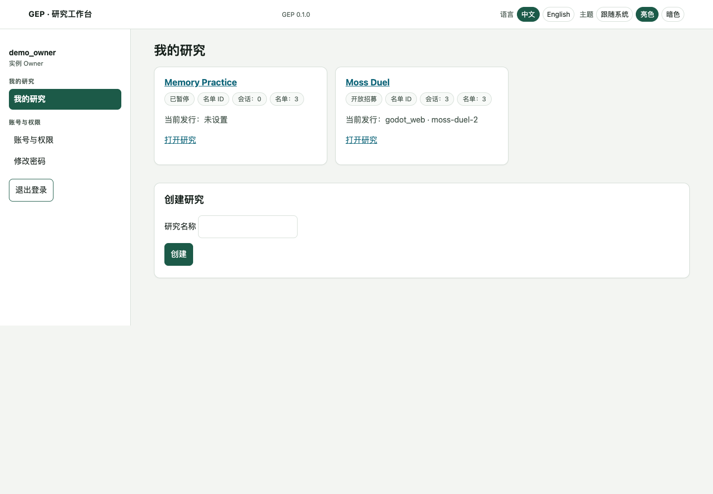
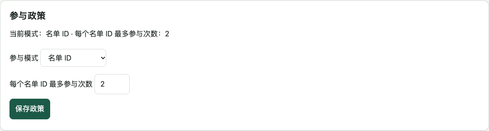
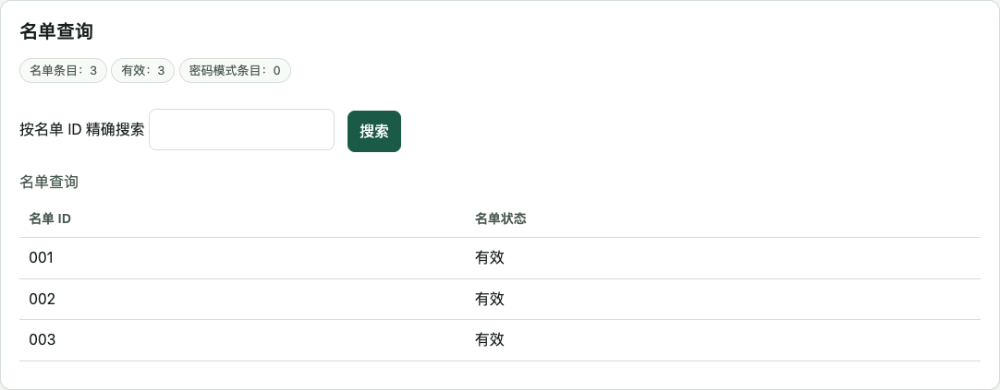
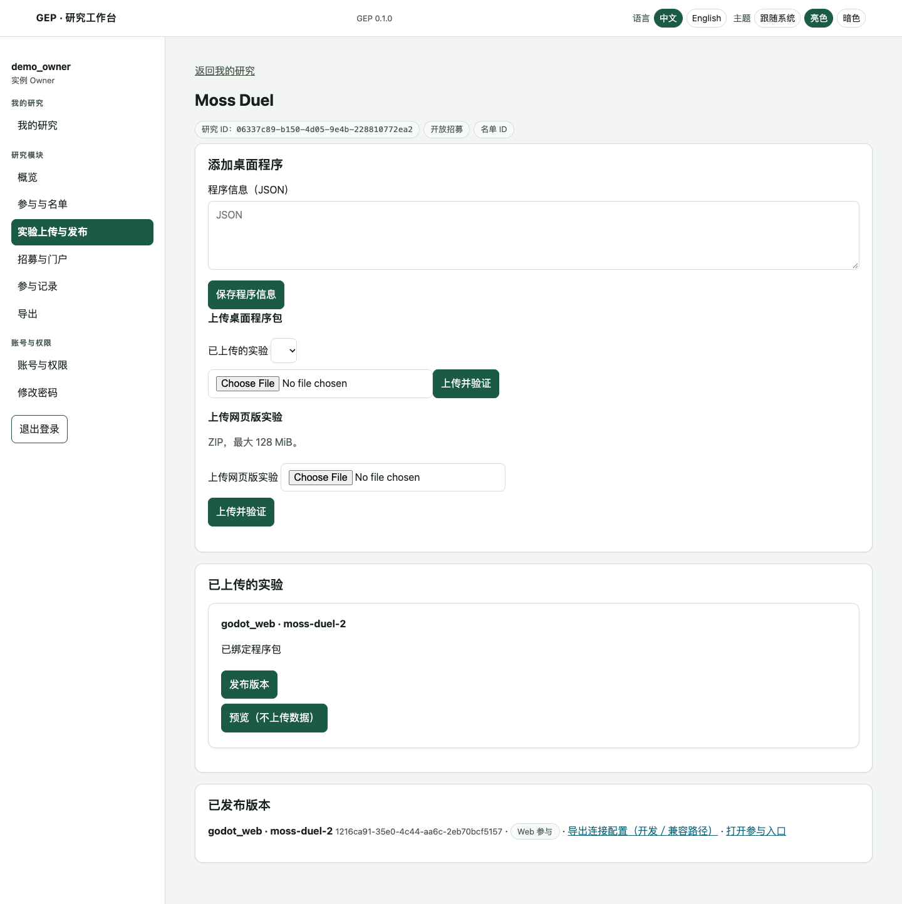
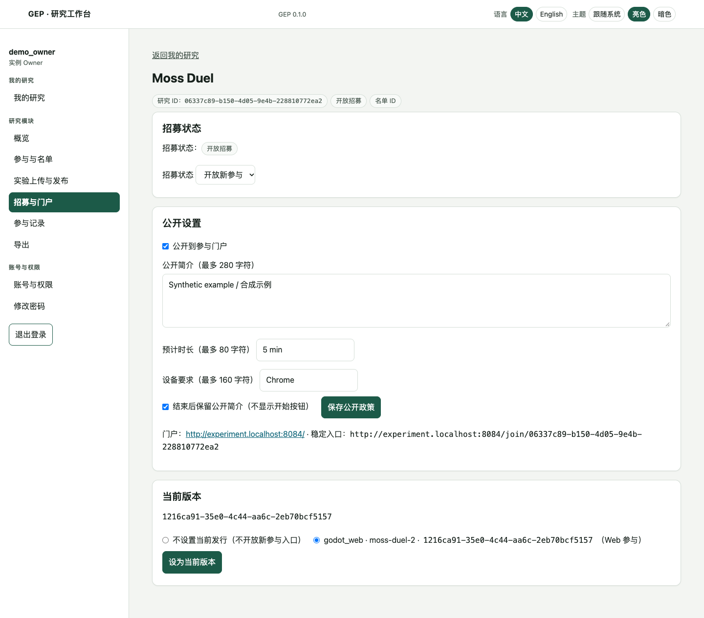
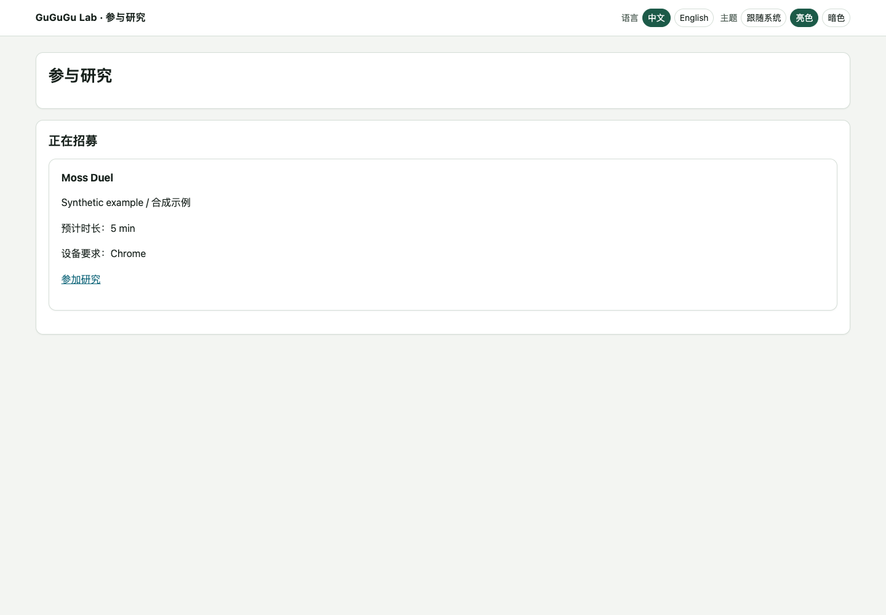
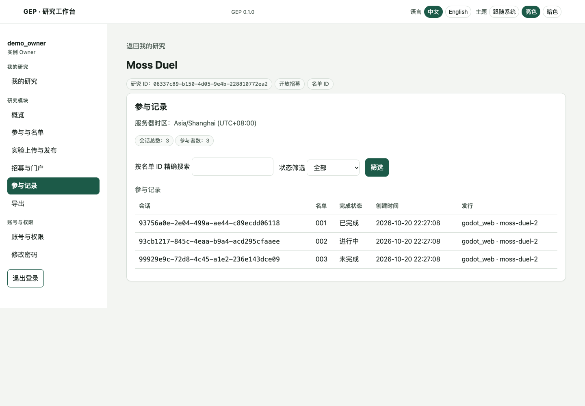
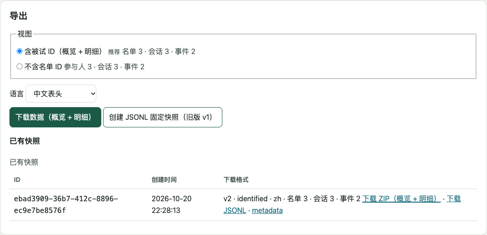
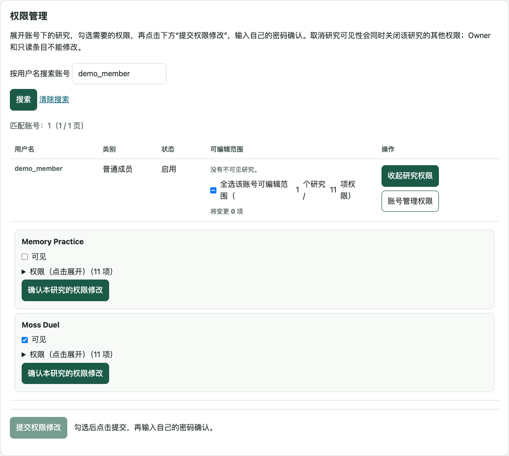
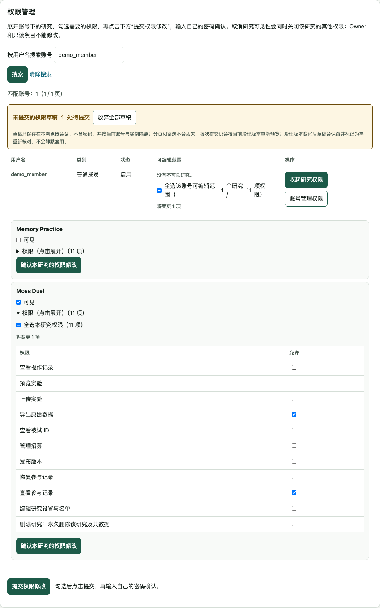

# GEP 详细使用教程

[English](researcher_en.md) · 中文

服务器还没部署时，先看[部署教程](deployment.md)。本教程从后台登录开始，使用当前界面的名称。涉及账号、名单和研究删除的操作，请在提交前核对目标；删除研究会同时删除它的数据。

截图使用合成研究、示例账号和数据。示例端口为 8084，使用时以自己的部署地址为准。切换教程语言后，配图也使用对应语言的界面；研究名称和名单 ID 不会被翻译。

## 1. 登录与首页

打开部署时确定的管理地址。本地默认是 `http://admin.localhost:8080/login`；公网通常为 `https://admin.<你的域名>/login`。不要把参与门户当作后台登录页。

新实例先填写 Owner 用户名、密码及确认密码。域名可选，留空即本地使用；填了也不会自动修改 DNS。普通成员使用 Owner／管理员提供的邀请或临时账号，首次使用临时密码时按页面要求修改密码。

登录后进入“我的研究”。这里只显示你有权查看的研究；没有研究时可按权限创建。语言切换只改变界面文案，不翻译研究名、名单 ID 或数据；主题可选择亮色、暗色或跟随系统。

## 2. 创建研究并选择参与方式

在“创建研究”填写研究名称并创建，进入研究的“参与与名单”模块，确认参与方式和次数限制：

| 方式 | 被试填写什么 | 研究者准备什么 |
|---|---|---|
| 无需 ID | 直接开始 | 不需要预发名单；系统区分参与记录 |
| ID | 预发的 ID | 导入允许参与的 ID 名单 |
| ID 与密码 | ID 和该 ID 的密码 | 导入 ID／密码名单 |

每个名单 ID 的最大参与次数可设为 1–1000。先完成这些设置，再发布首个版本。已有批准版本后，参与政策会冻结；不能靠修改研究设置改写旧版本或已有会话。

研究名称用于后台和公开展示，不要把被试姓名或其他私人信息写进公开标题。

## 3. 导入名单

在研究的“参与与名单”下载 XLSX 模板，用模板的表头填写。ID 列保持**文本格式**，例如 `001`，不要让 Excel 自动变成数字 1。密码方式还需填写密码列；被试密码与研究者账号密码使用不同规则。

上传后先看预览和逐行错误，再确认导入并输入自己的后台密码。任何行错误都会使整批不写入；导入只追加新 ID，不覆盖已有 ID。也可以使用页面提供的 CSV 文本入口，不必在输入框中手打制表符。

名单值按原文处理，不自动去掉首尾空白。前后空格同样是 ID／密码的一部分，被试之后必须原样输入。全空白 ID 不接受。公式、宏、外部链接或数字形式的 ID 会被拒绝。当前导入上限为压缩文件 2 MiB、展开 10 MiB、1000 行、32 列。

在这里查看已有名单、搜索特定 ID；权限不足时不会显示身份映射。名单文件含参与凭据，应放在受控位置，不上传公开仓库。

## 4. 上传 Web 实验

Godot 开发者按 [GEC 文档](gec_godot.md)提供标准 Web ZIP。不要直接压缩整个 Godot 工程来上传。

在“实验上传与发布”选择 ZIP 并上传。等待验证完成，页面出现平台、版本和对应实验记录。验证失败不改变旧版本；先看错误原因，不反复点击发布。页面显示当前 ZIP、展开大小及文件数限制。

安全审计分支只接受 Stored／Deflate 压缩的 ZIP／XLSX；XLSX 最多 256 个内部文件。标准 Godot 导出和本平台模板符合该规则。此补丁尚未替换已发布镜像，部署前查看[审计状态](SECURITY_AUDIT.md)。

若提示不支持 `pattern`／`patternProperties`，请让开发者修改数据结构定义并提供新包。该分支也会拒绝含这些正则规则的旧版本的新参与和相关事件；已有记录不变，待传数据保留，不要删除或换个发行重传。

点击“预览（不上传数据）”，打开实验并走完一次流程。核对参与入口、任务内容、记录字段和结束页面。**预览只在本地保存，不向正式参与记录上传数据**；看到本地保存不等于服务器已经收到。

预览符合预期后回到后台，点击“发布版本”。同一研究可以保留多个版本，发布新版本不会覆盖旧包或把旧参与记录移到新版。

## 5. 原生实验的不同之处

原生实验不提供 Web 隔离预览。开发者交付程序 ZIP 和配套描述 JSON；在“实验上传与发布”登记描述并上传对应平台程序包，发布后下载**完整实验包**。

完整包已经包含冻结的 `connection.json`，解压后保持文件结构，直接打开程序，不需要被试手工替换连接文件。macOS 为 `.app`，Windows x64 需保留 EXE、PCK 和原生依赖。不要只分享一个 EXE，也不要把后台密码放进程序包。

门户可以说明原生参与方式，但不会向未登录访客直接提供受保护的程序包下载。研究者按自己的分发安排交付完整包，再核对它指向正确的服务器、研究和版本。

## 6. 选择当前版本并开放参与

进入“招募与门户”：

1. 在“当前版本”选择本研究已发布且程序包可用的版本，点击“设为当前版本”。每个研究只有一个当前版本。
2. 需要在门户展示时，勾选“公开到参与门户”，填写公开简介、预计时长和设备要求，点击“保存公开政策”。
3. 将招募状态设为“开放新参与”。选择后立即保存；等待页面显示已保存状态。

分享 `https://experiment.<你的域名>/` 可以让被试选择公开研究；分享研究稳定入口 `/join/<study_id>` 可以直接进入该研究。你自己的个人网站只需放一个指向门户的链接。

门户只展示明确公开、正在招募且当前版本可用的研究。私有研究不会因为开放招募而自动公开。结束后的研究若要保留简介，勾选保留结束摘要；它不会提供开始按钮。

切换当前版本只影响之后从稳定入口开始的新参与。已有会话、旧链接、待上传数据和导出仍绑定原版本，不会自动迁移。

## 7. 暂停或结束招募

选择“暂停新参与”或“关闭新参与”都会拒绝新开始的参与；页面状态分别显示 paused／closed。暂停适合暂时停招，关闭表示这次招募已结束，但二者不等于删除研究或撤销已有会话。

已有有效会话仍按原授权窗口上传。不能把关闭招募当作清理待上传数据的工具；需要永久删除研究时，先阅读第 11 节。

## 8. 查看参与和完成状态

在参与记录页按 ID 搜索、按完成状态筛选，并核对时间和版本。身份映射不可见时，不显示具体名单 ID，不代表记录丢失。没有人工 ID 的参与会显示相应提示。

“已完成”表示服务器收到完成声明，且声明的事件／分段集合已收齐；“进行中”和“未完成”用于查看其他记录。GEC 的任务结束、本机保存和服务器收齐是三个不同状态：结束画面已经出现，但网络尚未完成上传时，不应手动判为服务器完成。

被试遇到上传问题时，先保留原设备、浏览器存储、程序目录和失败提示；不要清缓存、换版本或删除文件来隐藏问题。0.1.0 不公开恢复码／恢复许可入口；保留数据不等于承诺能恢复任务进度。

## 9. 导出数据

进入“导出”，按需要选择含被试 ID 或不含名单 ID 的视图，再点击“下载数据（概览 + 明细）”。系统先创建固定快照，再下载 ZIP，包含：

| 文件 | 内容 |
|---|---|
| `participants.csv` | 被试概览及会话状态 |
| `events.csv` | 每个已接收事件的明细 |

JSONL 和 `metadata.json` 是单独链接；metadata 记录 schema、codebook、会话声明等信息，不包含全部事件记录。快照不随之后新增的数据或研究改名而变化，需要新数据时创建新快照。

含 ID 的导出需要原始数据导出及身份映射读取权限。不含 ID 的视图不包含名单码或未参与名单，但不能仅凭这一点认定数据已完全匿名。下载时会重新检查权限，撤权后的旧链接同样失效。

CSV 的自由文本和 ID 列使用 `text:` 前缀，例如 `text:001`；JSON 值使用 `json:` 前缀，避免电子表格把原文当成公式。机器读取时只移除对应的开头前缀，再按文本或 JSON 解析。Excel／WPS 使用“从文本/CSV”导入，编码选 UTF-8，ID 和文本列设为文本。保真分析可直接用 JSONL。

若表格单元格或导出容量超限，页面拒绝表格导出，不会静默截断；保留 JSONL 获取路径，并按可用条件缩小导出范围。

## 10. 管理账号与权限

侧边栏的“账号与权限”是统一管理页，不必进入每个研究。Owner 拥有固定全部权限；Admin 能查看账号权限，但可修改的范围仍受自己有效权限和可转授权限限制，不能修改 Owner。

创建普通账号或邀请成员后，按页面完成激活／初次改密。账号管理和研究权限是两类设置：

- **账号管理权限：**是否可创建研究、创建或管理其他账号等，由 Owner 分配。
- **研究权限：**先勾选研究可见性，再展开细分权限；取消可见性会关闭其子权限，再打开不会自动恢复旧勾选。

在矩阵中勾选后点击“提交权限修改”，在确认框输入**自己当前账号**的密码，不是目标成员的密码。按页面核对提交后的结果；错误提示不代表已保存。展开按钮只向下增加表格，不会替你提交。

批量处理时先下载对应账号或权限模板，填写后上传、查看差异预览，再确认。模板中的用户名、操作和现有版本字段按模板要求保留，不猜测或覆盖已有账号。停用、重置密码和角色变更会影响已有登录；删除账号前确认目标和后果。

## 11. 删除研究

删除研究会永久删除该研究及其数据，已发布版本和旧参与入口会失效。先按自己的数据保留安排导出并备份，再核对研究名、删除确认及本人密码。删除不是“结束招募”的另一种写法。

研究删除后，旧客户端不再向该研究上传；设备上仍有的合法本地数据不会自动恢复到后台。不要清理尚未确认的数据。若只是结束招募，使用 closed，不使用删除。

## 12. 提交问题

记录发生在哪个页面、点击什么、预期和实际结果、时间与版本。截图前遮住账号秘密和被试信息；不要附上名单密码、原始被试记录、服务器卷或恢复证明。科学任务、评分、排除规则和数据用途由研究者决定，GEP 的完成状态不代替这些判断。
