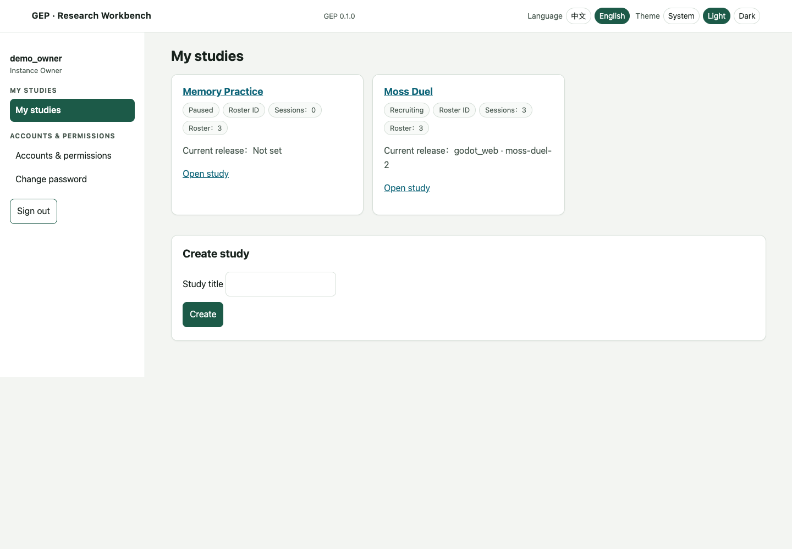
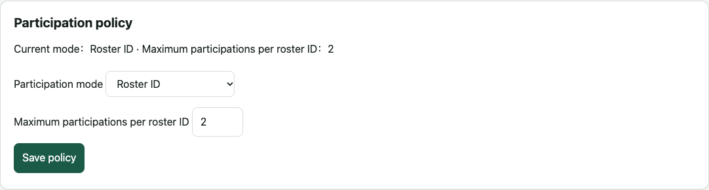
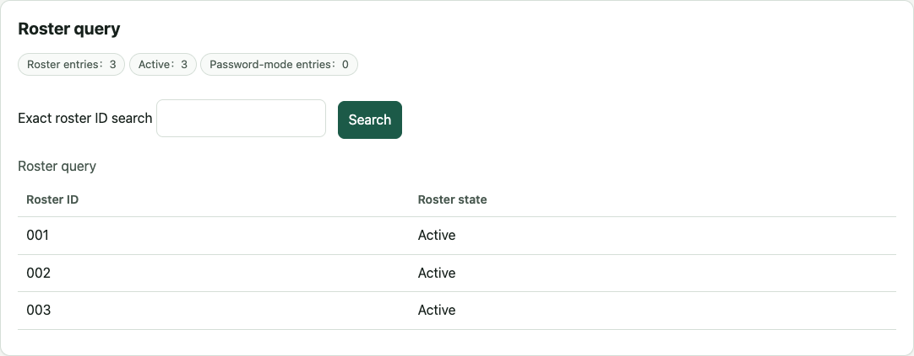
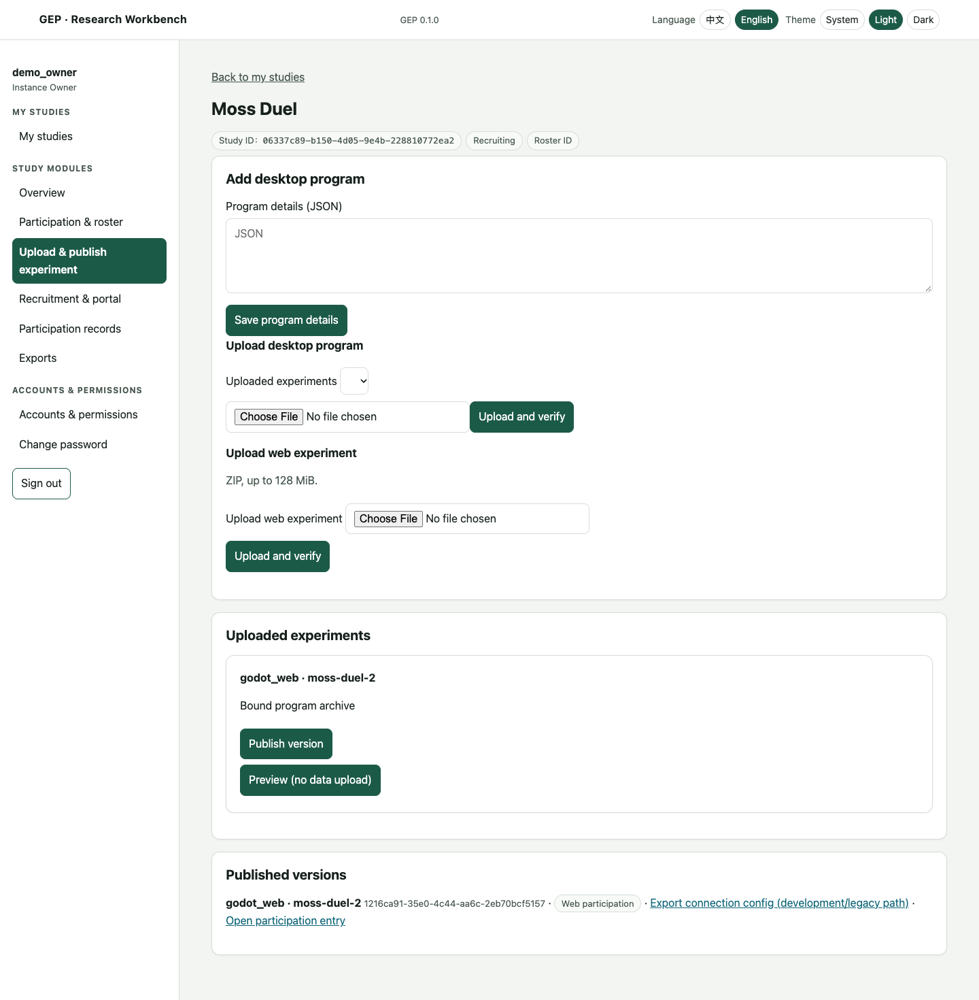
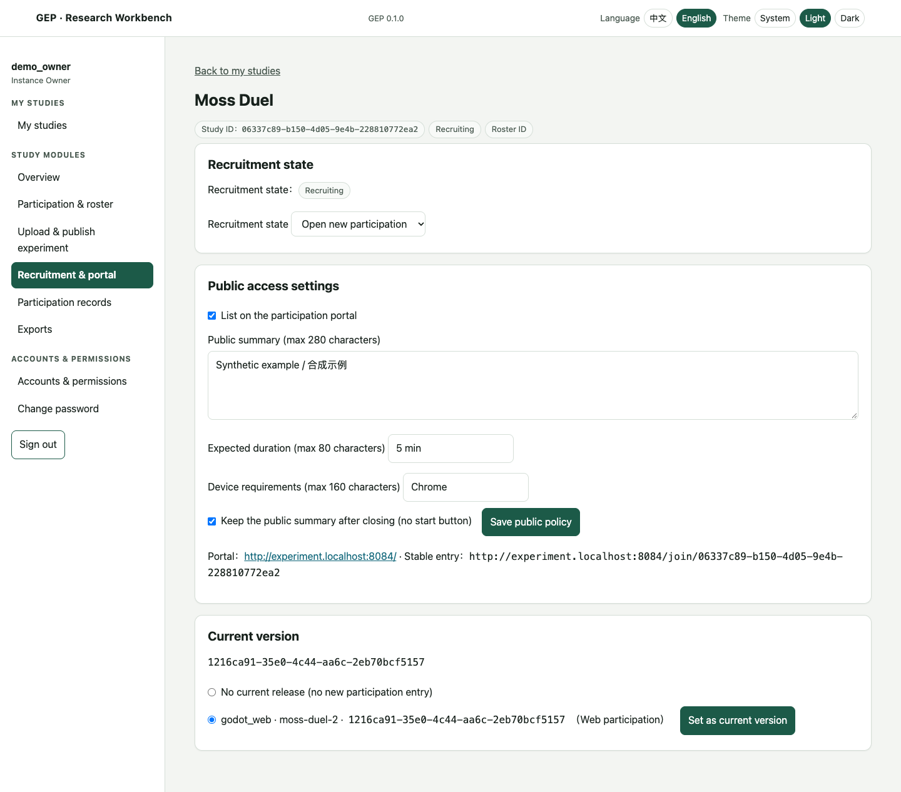
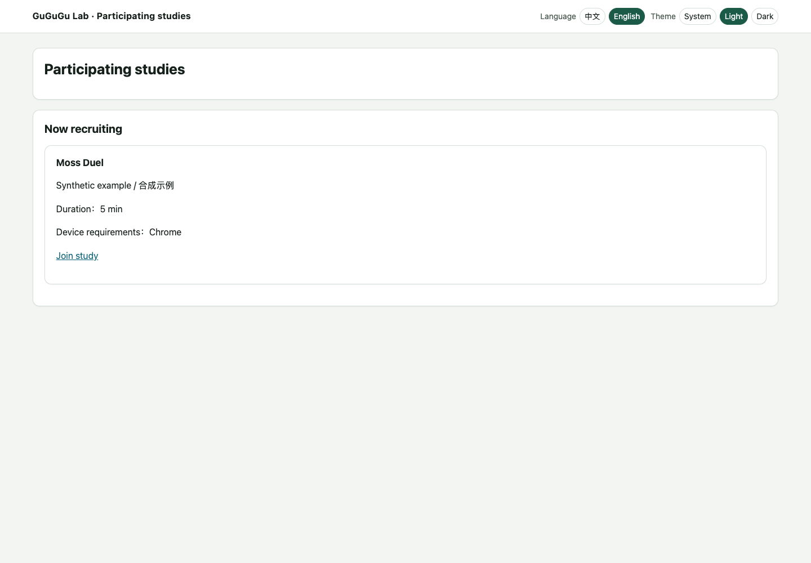
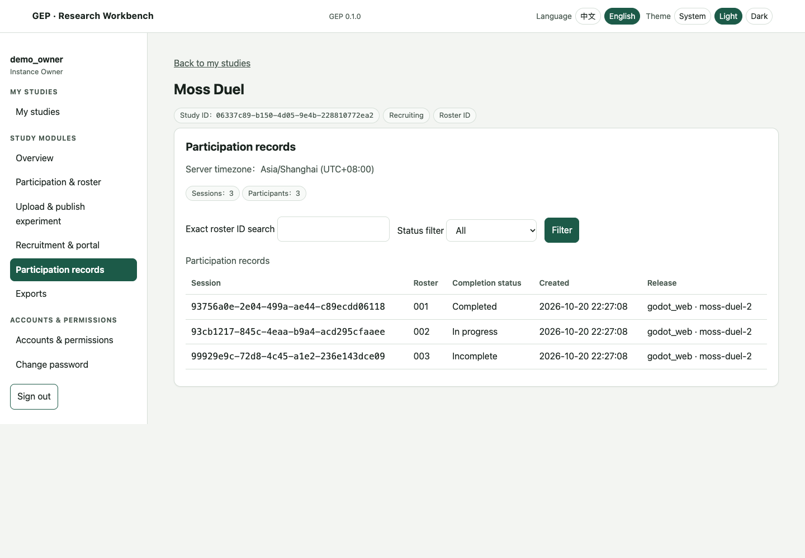
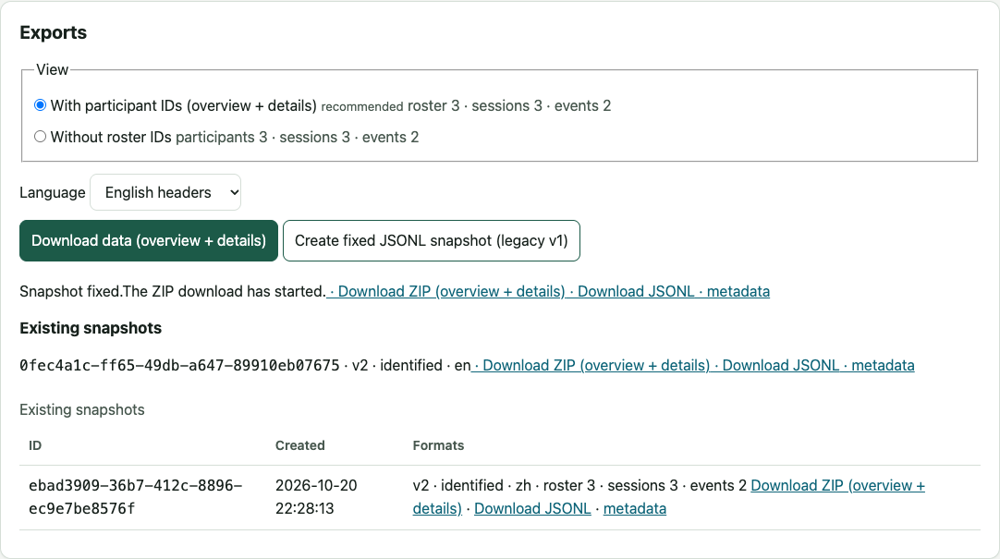
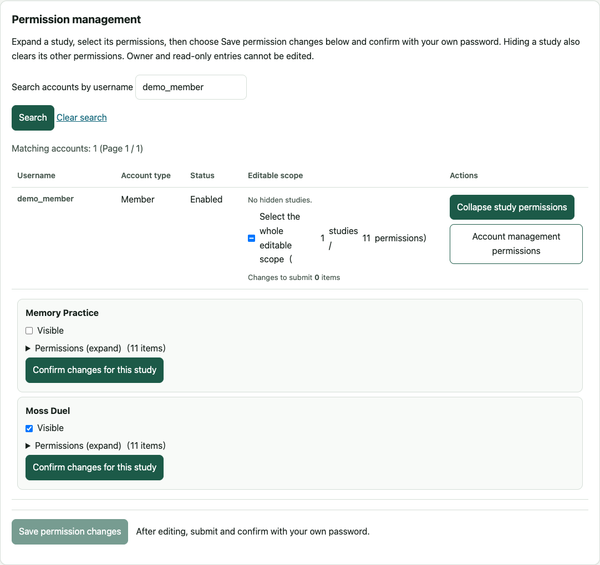
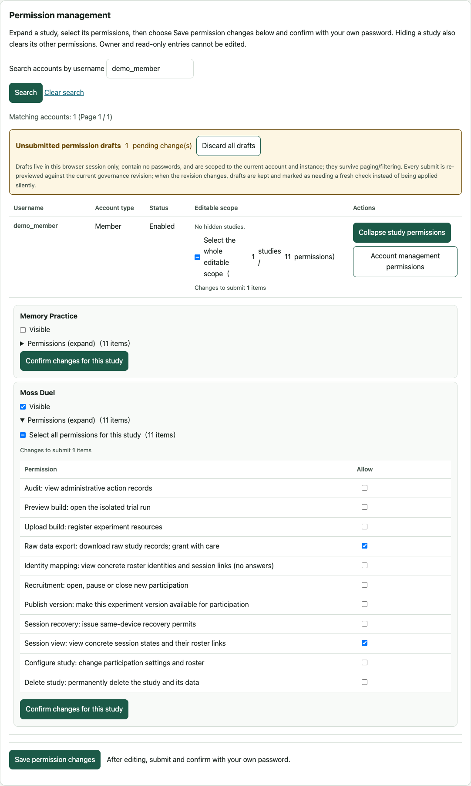

# GEP user guide

English · [中文](researcher.md)

Start with the [deployment guide](deployment_en.md) if the server is not installed. This guide follows the current workbench. Check the target before changing accounts, rosters or deleting a study: study deletion also deletes its data.

Screenshots use synthetic studies, example accounts and data on port 8084; use your own deployment address. Each guide language has matching interface screenshots. Study titles and roster IDs are not translated.

## 1. Sign in

Use the admin address selected during deployment: locally `http://admin.localhost:8080/login`, or normally `https://admin.<your-domain>/login`. The participant portal is not the workbench login page.

A new instance asks you to choose an Owner username and password. The optional domain does not configure DNS. Other members use an invitation or temporary account supplied by an authorized administrator; change a temporary password when prompted.

**My studies** lists studies you may view. Creation is available according to your permissions. The language switch changes interface labels, not study titles, roster IDs or recorded values. Themes can be light, dark or system-controlled.

After the HTTPS security update, sign in again and refresh old forms. Your account and password are unchanged.

## 2. Create a study

Enter a title in **Create study**, then open participation and roster settings:

| Mode | Participant enters | Researcher prepares |
|---|---|---|
| Anonymous | Start directly | No pre-issued ID list |
| ID | An issued ID | An allowed-ID roster |
| ID and password | Issued ID and its password | An ID/password roster |

The maximum participation count per roster ID is 1–1000. Configure participation before publishing the first version. After an approved release exists, participation policy is frozen; editing settings cannot rewrite an existing release or session.

Keep participant names and other private information out of publicly displayed study titles.

## 3. Import a roster

Download the study's XLSX template from participation and roster settings. Keep the ID column as **text**, so `001` is not converted to numeric 1. For password mode, fill the password column too; participant passwords have a different policy from researcher accounts.

Upload, inspect the preview and row errors, then confirm with **your own workbench password**. Any row error prevents the entire import from writing. New IDs are appended; existing IDs are not overwritten. The provided CSV text input is an alternative and does not require typing Tab characters.

Values are exact: surrounding spaces are not trimmed and must be entered by the participant too. All-whitespace IDs, numeric IDs, formulas, macros and external links are rejected. Current import limits are 2 MiB compressed, 10 MiB expanded, 1,000 rows and 32 columns.

Review or search the roster here. Identity mapping requires permission. Store roster files privately; they may contain participation credentials.

## 4. Upload a Web experiment

Have the developer supply a standard Web ZIP using the [GEC guide](gec_godot_en.md), not an archive of the entire Godot project.

In **Upload & publish experiment**, upload the ZIP and wait for validation. A successful entry displays its platform and version. Failure leaves the old release unchanged; inspect the error before retrying. The page states the current archive, expanded-size and file-count limits.

The security-audit branch accepts Stored/Deflate ZIP and XLSX compression only, with at most 256 internal files in an XLSX workbook. Standard Godot exports and GEP templates meet this rule. This patch has not replaced the released image; check the [audit status (Chinese)](SECURITY_AUDIT.md) before deployment.

If `pattern` or `patternProperties` is reported as unsupported, ask the developer to update the schema and supply a new package. This branch also refuses new admission and affected events for existing versions using these regex rules. Accepted records remain unchanged and pending data is retained; do not delete or relabel it under a different release.

Choose **Preview (no data upload)** and check entry, task, recorded fields and completion screen. **Preview saves locally only; it does not upload into live participation records.** Local saving is not server acknowledgement.

The audit branch gives previews and published versions separate addresses; follow the workbench links. An old address with local records opens a trusted handling page first. Data keeps its original binding, without automatic task resumption or transfer to a new version. Do not clear browser storage; contact the researcher for expired or paused records. Old caches and actual public deployment are not declared verified.

Return to the workbench and choose **Publish version** when satisfied. Multiple versions can be retained. A new publication does not overwrite an old package or relabel its sessions.

## 5. Native experiments

Native builds do not have a Web preview. Register the developer's descriptor JSON and upload its matching platform archive. After publication, download the **complete experiment package**.

It already includes the frozen `connection.json`. Keep the extracted structure and open the program directly. macOS uses a complete `.app`; Windows x64 needs its EXE, PCK and native dependencies. Do not distribute only an EXE or embed a workbench password.

The portal can explain native participation, but it does not expose protected package downloads to anonymous visitors. Distribute the complete package through your chosen channel and verify its server, study and version.

## 6. Choose the current version and recruit

In **Recruitment & portal**:

1. Select an approved, available version belonging to this study under **Current version** and choose **Set as current version**.
2. Enable **List on the participation portal**, fill its public summary, duration and device requirements, then choose **Save public policy**.
3. Choose **Open new participation**. Recruitment changes save immediately; wait for the saved state.

Share the participant portal `https://experiment.<your-domain>/`, or the stable study entry `/join/<study_id>`. Your personal website can simply link to the portal.

The portal lists only explicitly public, recruiting studies with an available current release. Open recruitment alone does not make a private study public. An ended study appears without a start button only if its ended summary was enabled.

Changing the current version affects new participation through the stable entry. Existing sessions, old links, pending uploads and exports retain their original binding.

## 7. Pause or close recruitment

Paused and closed both refuse new starts. Paused is a temporary stop; closed marks recruitment as ended. Neither deletes the study or automatically revokes existing sessions.

Existing valid sessions upload within their original authorization window. Closing recruitment is not a method for clearing pending data; read section 11 before permanent deletion.

## 8. Participation and completion

Use participation records to search an ID, filter completion state and check time and version. Without identity-mapping permission, roster IDs are hidden; that does not mean records are missing. Anonymous records are labelled as having no issued ID.

**Completed** means the server has a completion declaration and all declared events/segments. Other records are grouped as in progress or incomplete. Task finished, saved on this device and received by the server are separate facts: a finished task with pending upload is not yet server-complete.

When uploads fail, retain the original device, browser storage, program files and error details. Do not clear caches, switch versions or delete files to hide the failure. Recovery-code and permit controls are not exposed in 0.1.0. Retaining data does not guarantee task-state recovery.

## 9. Export data

In **Exports**, choose a view with or without issued participant IDs, then download the overview and event data. GEP creates a fixed snapshot and supplies a ZIP containing `participants.csv` and `events.csv`.

JSONL and `metadata.json` are separate links. Metadata describes schemas, codebook and session declarations; it is not the full event dataset. Later events or study renaming do not change an old snapshot. Create a new snapshot for updated data.

Identified exports need both raw-data export and identity-mapping permission. Unmapped exports omit roster codes and never-participating roster entries, but are not automatically anonymous. Permission is checked again at download, including old links after revocation.

CSV text and ID cells use a reversible `text:` prefix, such as `text:001`; JSON cells use `json:` to avoid spreadsheet formula interpretation. Machine readers remove only the matching leading prefix, then handle text or parse JSON. In Excel/WPS, import as UTF-8 text/CSV and set text/ID columns to text. Use JSONL for lossless analysis.

Cell or export-capacity limits refuse spreadsheet output rather than silently truncating it. Keep the JSONL route and narrow the scope using the available controls.

## 10. Accounts and permissions

Open the shared **Accounts & permissions** page, rather than entering each study. The Owner has fixed full access. Admins can inspect account permissions, but edits remain limited by their effective and delegable permissions; they cannot change the Owner.

Create an ordinary account or issue an invitation, then follow activation and initial-password steps. Account-management permissions and study permissions are separate:

- **Account management:** creating studies or creating/managing other accounts; assigned by the Owner.
- **Study permissions:** enable visibility before selecting detailed actions. Hiding a study clears its sub-permissions; showing it again does not restore old selections.

After editing the matrix, submit permission changes and enter **your own current password**, not the target member's password. Check the saved result. Expanding a row does not submit changes, and an error is not confirmation of a save.

For bulk changes, download the matching account or permission template, upload it, review differences and confirm. Retain required operation and current-revision fields; do not guess them or overwrite existing accounts. Disabling an account, resetting a password or changing a role can invalidate existing sign-ins. Check deletion targets carefully.

## 11. Delete a study

Deletion permanently removes the study and its data; published versions and old participation entries become unavailable. Export and back up according to your retention arrangements, then check the target and password confirmation. Deletion is not another label for closing recruitment.

Old clients can no longer upload to the deleted study. Legal local data still on a device is not automatically restored to the workbench. Retain unconfirmed data. Use closed recruitment, not deletion, if you only want to stop new participation.

## 12. Report a problem

Record the page, action, expected and actual result, time and version. Remove secrets and participant information from screenshots. Do not attach roster passwords, participant records, server volumes or recovery proofs. The researcher remains responsible for task design, scoring, exclusion and data use; a GEP completion status does not make those decisions.
